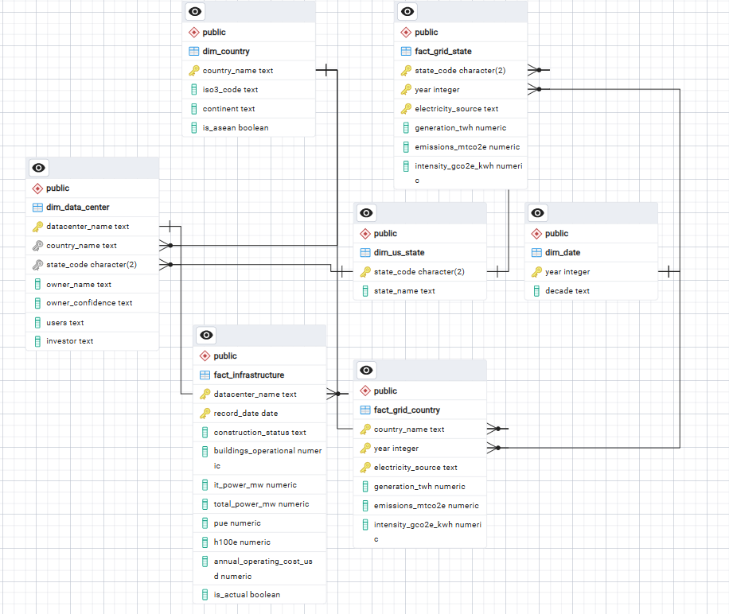
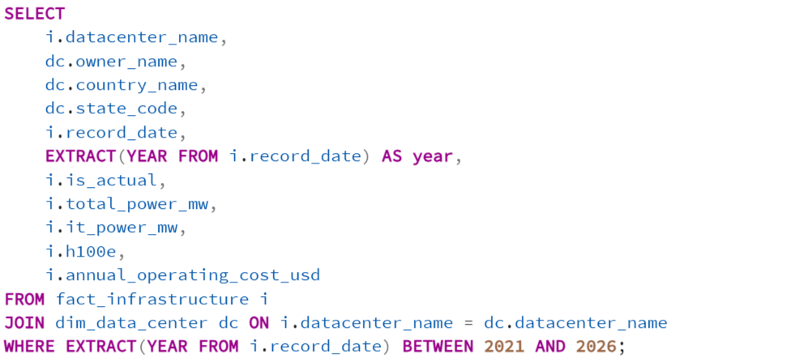

# Final Project: The Power Cost of AI Race

Proyek kolaboratif untuk menganalisa korelasi antara pertumbuhan pusat data AI global (Epoch AI) dan dampaknya terhadap kapasitas jaringan listrik serta emisi karbon regional (Ember Electricity Data).

---

## Team & Roles

* **Data Engineer (Zhafran Septama):** B Membangun pipeline ETL, Otomatisasi (Apache Airflow), Data cleaning dan Load data ke storage
* **Database & Documentation (Aisyah Sabrina Amalia):** DMerancang skema database, Manajemen database, Validasi kualitas data, serta Menyusun dokumentasi arsitektur sitem
* **Analyst & Dashboard (Aldi Zulkarnaen):**  Melakukan Exploratory Data Analysis (EDA), Membuat business insight dan rekomendasi, serta Merancang dashboard visualisasi interaktif

---

## Datasets

1. [Epoch AI Data Centers](https://epoch.ai/data/ai-data-centers)
2. [Ember Yearly Electricity Data](https://ember-energy.org/data/yearly-electricity-data/#explore-this-data)
3. [US Electricity Data](https://ember-energy.org/data/us-electricity-data/)

---
## Tableau

[Link Dashboard](https://public.tableau.com/app/profile/aldi.zulkarnaen/viz/ThePowerCostoftheAIRace/DASHBOARD)

---

## Problem Statement
Pembangunan data center AI di dunia tumbuh sangat cepat, sehingga kebutuhan listrik dan emisi karbonnya ikut melonjak. Kami membantu pembuat kebijakan energi, pengelola data center, dan investor menentukan di mana dan dengan standar efisiensi seperti apa data center AI berikutnya sebaiknya dibangun, dengan menganalisis data kapasitas dan lokasi data center AI dunia dan data listrik di negara tempat data center itu berada, agar emisi dari data center AI baru bisa turun sekitar 20%, dari rata-rata saat ini ke tingkat data center paling ramah lingkungan yang sudah ada.

---

## Objective

Menganalisis seberapa besar, seberapa efisien, dan di mana data center AI dunia dibangun per 2026 menggunakan data Epoch AI dan Ember, untuk mengukur kapasitas listrik (MW), efisiensi energi (PUE), kebersihan sumber listrik (gCO2e/kWh), emisi tahunan, dan kapasitas komputasi per MW, sehingga pembangunan data center AI berikutnya bisa diarahkan ke lokasi dan standar yang lebih hemat energi dan rendah emisi.

---

## Stakeholder
Pembuat Kebijakan Energi, Manajemen Data Center, dan Investor

---

## Keterkaitan dengan Sustainable Development Goals (SDGs)

Proyek **THE POWER COST OF AI RACE** selaras dengan beberapa poin dalam *Sustainable Development Goals* (SDGs) berikut:

| SDG | Nama Tujuan SDGs | Keterkaitan dengan Proyek | Fokus Analisis / Metrik Terkait |
| :--- | :--- | :--- | :--- |
| **SDG 7** | **Energi Bersih dan Terjangkau** (*Affordable and Clean Energy*) | Mengukur besarnya kebutuhan listrik pusat data AI terhadap kapasitas pembangkitan listrik wilayah/negara serta menilai tingkat kebersihan/karbon grid yang menyuplai fasilitas tersebut. | Konsumsi energi pusat data (`TWh`), persentase beban grid wilayah (`burden_percentage`), intensitas karbon grid (`gCO2e/kWh`), dan ambang batas kelayakan energi bersih. |
| **SDG 9** | **Industri, Inovasi, dan Infrastruktur** (*Industry, Innovation and Infrastructure*) | Menelusuri ekspansi infrastruktur komputasi dan pusat data AI lintas negara, pemilik fasilitas, serta efisiensi teknis operasionalnya. | Pertumbuhan kapasitas daya total (`MW`) & daya IT (`MW`), ekuivalen komputasi (`H100e`), efisiensi energi fasilitas (`PUE`), dan biaya operasional tahunan (`USD`). |
| **SDG 13** | **Penanganan Perubahan Iklim** (*Climate Action*) | Menghitung dampak jejak karbon akibat lonjakan konsumsi daya pusat data AI dan membandingkan kelayakan lokasi berdasarkan intensitas emisi grid. | Estimasi emisi karbon (`MtCO2e`), intensitas karbon tertimbang (*weighted carbon intensity*) per wilayah/negara, serta matriks kesesuaian lokasi. |
| **SDG 12** | **Konsumsi dan Produksi yang Bertanggung Jawab** (*Responsible Consumption and Production*) | Mendorong efisiensi pemanfaatan sumber daya energi dan infrastruktur komputasi agar pertumbuhan AI tetap efisien secara daya dan biaya. | Efisiensi `PUE` per fasilitas/wilayah, rasio komputasi terhadap daya IT (`h100e_per_it_mw`), dan efisiensi biaya per unit komputasi. |

### Ringkasan Fokus SDG
* **Fokus Utama:** **SDG 7**, **SDG 9**, dan **SDG 13** merupakan tiga pilar utama yang terhubung langsung dengan evaluasi ekspansi infrastruktur AI, tekanan terhadap sistem ketenagalistrikan nasional/regional, dan dampak emisi karbon.
* **SDG Pendukung:** **SDG 12** menjadi konteks pendukung dalam mengukur efisiensi operasional sumber daya energi dan biaya komputasi.

## Key Questions

1. Bagaimana tren pertumbuhan kapasitas listrik (MW) dan kapasitas komputasi (H100e) data center AI dunia sejak 2021, dan perusahaan mana yang paling besar kontribusinya?
2. Seberapa besar konsumsi listrik dan estimasi emisi karbon data center AI dunia setiap tahun sejak 2021, dan bagaimana trennya?
3. Seberapa efisien data center AI, dilihat dari PUE serta perbandingan kapasitas komputasi (H100e) dengan konsumsi listrik, emisi, dan biaya operasional, dan data center mana yang paling efisien?
4. Di wilayah mana beban listrik data center AI paling besar dibanding total pembangkitan listrik wilayah tersebut?
5. Negara atau wilayah mana yang paling dan paling tidak ideal untuk membangun data center AI, berdasarkan intensitas karbon listrik, beban terhadap pembangkitan listrik, efisiensi, dan biaya operasional?

---

## Data Engineering
### System Architecture & Pipeline

```text
[Raw Data Sources: Epoch & Ember]
               │
               ▼
[ETL Pipeline & Airflow DAGs] (Data Engineer)
               │
               ▼
[PostgreSQL Database / Dimensional Galaxy Schema] (Database)
               │
               ▼
[EDA & Data Modeling] ──► [Interactive Dashboard] (Analyst)
```

* **Extraction,Transformation & Load (ETL):** Data mentah diekstrak menggunakan kaggle API 
* **Transformation:** Pembersihan dan pemformatan data menggunakan PySpark
* **Validation:** Memastikan data mematuhi logika bisnis menggunakan great expectation
* **Load:** Memindahkan data yang sudah bersih ke database PostgreSQL
* **Airflow:** Menggunakan dag (dc_electricity_olap_pipeline.py) yang berisi 4 task extract-transform-validate-load
* **Data Modeling:** Data yang telah dibersihkan dimuat ke dalam database menggunakan skema *Fact Constellation* (Galaxy).
* **Analysis & Visualization:** Data diproses untuk mengungkap tren historis, anomali, dan proyeksi dampak lingkungan melalui dasbor interaktif.

---

## Database & Data Modeling
### 1. Skema arsitektur
Menggunakan **PostgreSQL** sebagai *Data warehouse* dengan model Galaxy Schema (Fact Constellation). Arsitektur ini dipilih karena proyek menggabungkan dua domain data berbeda—linimasa infrastruktur data center (Epoch AI) dan kelistrikan/emisi global (Ember)—ke dalam tiga tabel fakta yang saling berbagi empat tabel dimensi bersama. Selain itu, dimensi geografis menerapkan normalisasi antara tingkat negara dan negara bagian AS guna mendukung analisis lintas-skala (makro/nasional vs. mikro/lokal).



---

### 2. Struktur Tabel (*Data Modeling*)

#### 📌 Tabel Dimensi (*Dimension Tables*)
Tabel dimensi menyimpan atribut deskriptif dan referensi data master sebagai konteks analisis:

| Nama Tabel | Deskripsi | Atribut / Peran Utama |
| :--- | :--- | :--- |
| **`dim_date`** | Referensi dimensi waktu untuk analisis tren jangka panjang. | `year`, `decade` |
| **`dim_country`** | Data master wilayah negara secara global (acuan standar Epoch AI & Ember). | `country_id`, `country_name`, `iso_code` |
| **`dim_us_state`** | Daftar negara bagian khusus Amerika Serikat untuk analisis granular di dalam negeri AS. | `state_code`, `state_name`, `country_id` |
| **`dim_data_center`** | Profil statis dan identitas utama setiap fasilitas pusat data AI (*latest snapshot*). | `site_id`, `site_name`, `owner`, `current_h100e`, lokasi (`country`/`state`) |

#### 📊 Tabel Fakta (*Fact Tables*)
Tabel fakta menyimpan pengukuran numerik (*metrics*) dan rekam jejak historis (*time-series*):

| Nama Tabel | Deskripsi | Metrik Utama |
| :--- | :--- | :--- |
| **`fact_infrastructure`** | Merekam linimasa historis perkembangan fisik setiap pusat data dari waktu ke waktu. | `it_power_mw`, `total_power_mw`, `pue`, `h100e` (kapasitas komputasi historis), `annual_operating_cost_usd` |
| **`fact_grid_country`** | Menyimpan data tahunan sektor ketenagalistrikan dan emisi karbon tingkat nasional per negara. | `generation_twh`, `emissions_mtco2e`, `intensity_gco2e_kwh` |
| **`fact_grid_state`** | Menyimpan data tahunan ketenagalistrikan dan emisi khusus tingkat negara bagian di AS. | `generation_twh`, `emissions_mtco2e`, `intensity_gco2e_kwh` |

---

### 3. Keunggulan Pemodelan Data Ini
* **Pemisahan Atribut Statis vs. Historis:** Memisahkan kapasitas mutakhir (`current_h100e` di `dim_data_center`) dari pertumbuhan kapasitas berkala (`h100e` di `fact_infrastructure`) mencegah redudansi data pada catatan *time-series*.
* **Analisis Multi-Granularitas:** Pemisahan `fact_grid_country` dan `fact_grid_state` memungkinkan evaluasi beban listrik *data center* secara presisi di tingkat lokal (negara bagian AS) agar tidak terdistorsi oleh efek rata-rata nasional (*dilution effect*).
* **Siap untuk Analitik & Visualisasi:** Struktur relasional dengan *Primary Key* dan *Foreign Key* yang terdefinisi jelas mempermudah proses agregasi kueri SQL untuk menghitung efisiensi energi (`PUE`), konsumsi energi tahunan (`TWh`), serta intensitas emisi per kapasitas daya (`Emissions per MW`).

### SQL & Analytics
Untuk mendukung analisis dan menjawab berbagai pertanyaan riset (Key Questions) tanpa harus menyusun sintaks JOIN yang rumit secara berulang, dirancang SQL Views terpusat yang menghubungkan fact table dengan berbagai dimension table.

Contoh query untuk melihat tren pertumbuhan kapasitas listrik (MW) dan kapasitas komputasi (H100e) data center AI dunia sejak 2021-2026



## Data Dictionary

### A. `dim_country`
*Tabel yang menyimpan informasi negara tempat data center berada serta informasi geografis negara tersebut.*

| Nama Kolom | Tipe Data | Key / Constraint | Deskripsi |
| :--- | :--- | :--- | :--- |
| `country_name` | TEXT | Primary Key | Nama negara sebagai identitas unik negara. |
| `iso3_code` | TEXT | - | Kode negara berdasarkan standar ISO 3166-1 alpha-3, terdiri dari 3 huruf. |
| `continent` | TEXT | - | Nama benua tempat negara berada. |
| `is_asean` | BOOLEAN | - | Menunjukkan apakah negara merupakan anggota ASEAN (`TRUE`) atau bukan (`FALSE`). |

---

### B. `dim_us_state`
*Tabel yang menyimpan informasi negara bagian di Amerika Serikat. Digunakan untuk mengidentifikasi lokasi data center di wilayah AS.*

| Nama Kolom | Tipe Data | Key / Constraint | Deskripsi |
| :--- | :--- | :--- | :--- |
| `state_code` | CHAR(2) | Primary Key | Kode unik untuk negara bagian AS. |
| `state_name` | TEXT | NOT NULL | Nama negara bagian di AS. |

---

### C. `dim_data_center`
*Tabel yang menyimpan informasi identitas, lokasi, kepemilikan, dan pihak yang berkaitan dengan data center.*

| Nama Kolom | Tipe Data | Key / Constraint | Deskripsi |
| :--- | :--- | :--- | :--- |
| `datacenter_name` | TEXT | Primary Key, NOT NULL | Nama Data Center. |
| `country_name` | TEXT | Foreign Key | Negara tempat data center berada (`dim_country`). |
| `state_code` | CHAR(2) | Foreign Key | Kode negara bagian AS, bernilai `NULL` jika di luar AS (`dim_us_state`). |
| `owner_name` | TEXT | - | Nama perusahaan pemilik data center. |
| `owner_confidence` | TEXT | - | Tingkat keyakinan/keandalan informasi kepemilikan data center. |
| `users` | TEXT | - | Informasi pengguna layanan data center. |
| `investor` | TEXT | - | Nama pihak yang berinvestasi dalam pengembangan data center. |

---

### D. `dim_date`
*Tabel yang menyimpan informasi waktu berdasarkan tahun, digunakan untuk mengelompokkan data ke dalam periode tertentu.*

| Nama Kolom | Tipe Data | Key / Constraint | Deskripsi |
| :--- | :--- | :--- | :--- |
| `year` | INT | Primary Key | Tahun pencatatan data. |
| `decade` | TEXT | NOT NULL | Periode dekade yang mencakup tahun tersebut. |

---

### E. `fact_infrastructure`
*Tabel yang menyimpan informasi mengenai infrastruktur dan kapasitas operasional data center.*

| Nama Kolom | Tipe Data | Key / Constraint | Deskripsi |
| :--- | :--- | :--- | :--- |
| `datacenter_name` | TEXT | Foreign Key, Primary Key | Nama data center (`dim_data_center`). |
| `record_date` | DATE | Primary Key | Tanggal pencatatan atau pembaruan informasi. |
| `construction_status` | TEXT | - | Status pembangunan data center. |
| `buildings_operational` | NUMERIC | - | Jumlah bangunan/fasilitas yang telah beroperasi. |
| `it_power_mw` | NUMERIC | - | Kapasitas daya listrik untuk peralatan IT (dalam Megawatt). |
| `total_power_mw` | NUMERIC | - | Total kapasitas daya listrik fasilitas secara keseluruhan (dalam Megawatt). |
| `pue` | NUMERIC | - | Power Usage Effectiveness (Rasio total energi terhadap energi IT). |
| `h100e` | NUMERIC | - | Estimasi kapasitas komputasi setara chip Nvidia H100. |
| `annual_operating_cost_usd` | NUMERIC | - | Estimasi biaya operasional per tahun dalam Dolar AS (USD). |

---

### F. `fact_grid_country`
*Tabel yang menyimpan informasi pembangkit listrik dan emisi karbon berdasarkan negara, tahun, serta jenis sumber energi.*

| Nama Kolom | Tipe Data | Key / Constraint | Deskripsi |
| :--- | :--- | :--- | :--- |
| `country_name` | TEXT | Foreign Key, Part of PK | Nama negara lokasi pencatatan kelistrikan (`dim_country`). |
| `year` | INT | Foreign Key, Part of PK | Tahun pencatatan data (`dim_date`). |
| `electricity_source` | TEXT | Part of PK | Jenis sumber energi pembangkit listrik (cth: Coal, Solar, Total). |
| `generation_twh` | NUMERIC | - | Jumlah energi listrik yang dihasilkan (dalam TWh). |
| `emissions_mtco2e` | NUMERIC | - | Jumlah emisi gas rumah kaca (dalam Juta Ton $CO_2e$). |
| `intensity_gco2e_kwh` | NUMERIC | - | Intensitas emisi karbon (dalam $gCO_2e/kWh$). |

---

### G. `fact_grid_state`
*Tabel yang menyimpan informasi pembangkit listrik dan emisi karbon berdasarkan negara bagian di AS.*

| Nama Kolom | Tipe Data | Key / Constraint | Deskripsi |
| :--- | :--- | :--- | :--- |
| `state_code` | CHAR(2) | Foreign Key, Part of PK | Kode negara bagian AS lokasi pencatatan (`dim_us_state`). |
| `year` | INT | Part of PK | Tahun pencatatan data. |
| `electricity_source` | TEXT | Part of PK | Jenis sumber energi pembangkit listrik. |
| `generation_twh` | NUMERIC | - | Jumlah energi listrik yang dihasilkan (dalam TWh). |
| `emissions_mtco2e` | NUMERIC | - | Jumlah emisi gas rumah kaca (dalam Juta Ton $CO_2e$). |
| `intensity_g_kwh` | NUMERIC | - | Intensitas emisi karbon dari pembangkit listrik (dalam $g/kWh$). |

---

## Key Performance Indicators
**1. Total IT Power (MW)** · KQ1\
**Explanation:** Mengukur total daya listrik yang dipakai langsung oleh server dan chip di seluruh AI data center, dalam megawatt.\
**Purpose:** Mengetahui seberapa besar kapasitas AI data center saat ini dan seberapa cepat kapasitas itu bertambah dari tahun ke tahun.

**2. Owner Share (%)** · KQ1\
**Explanation:** Mengukur persentase IT power milik tiap perusahaan dari total IT power seluruh data center.\
**Purpose:** Mengidentifikasi perusahaan yang paling banyak berkontribusi dan seberapa terkonsentrasi kepemilikan kapasitas AI data center.

**3. Annual Electricity Consumption (TWh/year)** · KQ2\
**Explanation:** Mengukur perkiraan listrik yang dipakai AI data center dalam setahun, dihitung dari total facility power × 8.760 jam × utilization 70%.\
**Purpose:** Mengetahui besarnya kebutuhan listrik AI data center dan membandingkannya dengan produksi listrik suatu wilayah.

**4. Annual Emissions (MtCO2e/year)** · KQ2\
**Explanation:** Mengukur perkiraan emisi karbon per tahun, dihitung dari konsumsi listrik tahunan × grid carbon intensity tahun 2025 di lokasi data center.\
**Purpose:** Mengetahui dampak lingkungan dari pertumbuhan AI data center dan menjadi dasar target penurunan emisi.

**5. Power Usage Effectiveness (PUE)** · KQ3\
**Explanation:** Mengukur efisiensi energi gedung, dihitung dari total facility power dibagi IT power. Nilai yang makin dekat ke 1 berarti makin efisien.\
**Purpose:** Mengetahui seberapa banyak listrik yang terpakai untuk pendingin dan kebutuhan non-komputer, serta menentukan target efisiensi yang realistis.

**6. Compute per MW (H100e/MW)** · KQ3\
**Explanation:** Mengukur kapasitas komputasi yang dihasilkan untuk setiap megawatt IT power, dinyatakan setara jumlah chip NVIDIA H100.\
**Purpose:** Membandingkan seberapa produktif tiap data center dalam mengubah listrik menjadi kapasitas komputasi.

**7. Operating Cost per MW (USD/MW/year)** · KQ3\
**Explanation:** Mengukur biaya operasional tahunan data center untuk setiap megawatt IT power.\
**Purpose:** Memberi gambaran biaya operasional sebagai bahan pertimbangan investor dan manajemen data center.

**8. Emissions per MW (tCO2e/MW/year)** · KQ3 & KQ5\
**Explanation:** Mengukur emisi tahunan untuk setiap megawatt total facility power.\
**Purpose:** Membandingkan emisi antar data center secara adil tanpa terpengaruh ukuran, sekaligus menunjukkan pengaruh lokasi terhadap emisi.

**9. Share of Local Generation (%)** · KQ4\
**Explanation:** Mengukur persentase listrik tahunan AI data center terhadap total produksi listrik (Total generation) di negara atau negara bagian tempatnya berada.\
**Purpose:** Mengidentifikasi wilayah yang jaringan listriknya paling terbebani oleh AI data center, karena rata-rata nasional bisa menutupi tekanan di tingkat lokal.

**10. Grid Carbon Intensity (gCO2e/kWh)** · KQ5\
**Explanation:** Mengukur banyaknya emisi karbon untuk menghasilkan 1 kWh listrik di suatu negara atau negara bagian, berdasarkan data Ember tahun 2025.\
**Purpose:** Menentukan lokasi terbaik dan terburuk untuk membangun AI data center berdasarkan seberapa bersih sumber listriknya.

---

## Key Questions & Findings
**KQ1** : Kapasitas IT naik dari 48 MW (akhir 2021) menjadi 15.122 MW (November 2026), dan kapasitas komputasi dari sekitar 0,01 juta menjadi 15,77 juta H100e.Tiga perusahaan terbesar adalah Google (3.179 MW), Meta (2.335 MW), dan Amazon (1.870 MW), yang bersama-sama menguasai 48,8% kapasitas. Ada 1.869 MW yang pemiliknya tidak diketahui (Unknown), jadi porsi perusahaan besar sebenarnya bisa lebih tinggi.\
**KQ2** : Konsumsi listrik naik dari 0,3 TWh (2021) menjadi 119,4 TWh (2026), dan emisinya dari 0,1 menjadi 52,2 MtCO2e per tahun. Lonjakan terbesar terjadi di dua tahun terakhir: emisi 2026 lebih dari dua kali lipat emisi 2025 (22,8 Mt). Catatan: dataset hanya melacak data center yang sekarang sudah besar, jadi angka tahun-tahun awal cenderung lebih kecil dari kondisi sebenarnya.\
**KQ3** : Berdasarkn PUE hampir semua data center ada di 1,2–1,4 (median 1,30), jadi efisiensi gedungnya mirip. Kapasitas komputasi per MW adalah 1.137 H100e, dengan biaya operasional sekitar 0,69 juta USD per MW per tahun dan emisi 2.326 tCO2e per MW. Yang paling berbeda justru emisinya: dari sekitar 170 tCO2e per MW di Islandia sampai 4.300 tCO2e per MW di Batam. Artinya, emisi lebih ditentukan oleh sumber listrik di lokasi daripada efisiensi gedung.\
**KQ4** : Tennessee 14,9%, Nebraska 13,0%, Indiana 8,3%, sedangkan secara nasional AS hanya 2,2%. Artinya, angka nasional menyembunyikan beban di tingkat lokal: di beberapa negara bagian, data center AI sudah memakai sekitar sepertujuh listrik yang dibangkitkan. Di level negara, porsi tertinggi ada di Malaysia (5,0%).\
**KQ5** :
Ideal: Norwegia, Islandia (28), Finlandia (59), Portugal (128)
Tidak ideal: Australia, China, Malaysia, Indonesia (705).

---
## Conclusion

Tujuan project ini adalah mengarahkan pembangunan AI data center berikutnya ke lokasi yang lebih bersih dan lebih efisien. Hasil analisis menunjukkan kapasitas AI data center tumbuh sangat cepat, dari 48 MW pada 2021 menjadi 15.122 MW per November 2026 (Q1). Karena data center ini memakai listrik dari grid, konsumsi listrik dan emisinya ikut naik, sekitar 119 TWh dan 52,2 juta ton CO2e per tahun pada utilisasi 70% (Q2).

Efisiensi bangunan ternyata sudah mirip di hampir semua site, dengan median PUE 1,30 (Q3). Artinya, memperbaiki sistem pendingin saja tidak cukup untuk menekan emisi. Pembeda terbesarnya adalah lokasi. Beban ke grid bersifat lokal: secara nasional AI data center hanya memakai 2,2% listrik Amerika Serikat, tetapi di Tennessee mencapai 14,9% (Q4). Site dengan ukuran yang sama juga bisa menghasilkan emisi hingga 25 kali lebih besar di grid berbasis batu bara dibanding grid yang bersih (Q5).

Jadi, AI data center tidak bermanfaat atau berbahaya dengan sendirinya. Dampaknya bergantung pada di mana dan bagaimana ia dibangun. Memilih grid yang bersih dan belum terbebani, ditambah menargetkan PUE di level terbaik (1,20), adalah cara paling langsung untuk mencapai target pengurangan emisi per MW pada data center baru sekitar 20%.

**Keterbatasan:** sebagian besar site dalam data berada di Amerika Serikat (77 dari 96). Kapasitas dan PUE adalah estimasi Epoch AI, utilisasi diasumsikan 70%, dan emisi dihitung dari rata-rata intensitas grid, bukan dari kontrak energi bersih masing-masing perusahaan.

---

## Prerequisites & Setup

* Python 3.10+
* PostgreSQL / pgAdmin 4
* Docker & Apache Airflow (untuk orkestrasi pipeline ETL)

---

## Project Structure

```text
ai-energy-footprint-project/
├── dags/                  # Apache Airflow DAGs untuk otomatisasi ETL
├── data/                  # File data mentah (raw) dan hasil olahan (processed)
├── docs/                  # Dokumentasi diagram arsitektur & skema ERD
├── notebooks/             # Jupyter Notebooks untuk EDA & eksperimen data
├── sql/                   # Skrip DDL untuk pembuatan skema database
├── src/                   # Kode sumber pipeline ETL (Python scripts)
└── README.md              # Dokumentasi utama proyek
```

---

## License

Proyek ini dikembangkan untuk kebutuhan *final project* akademik dan profesional. Silakan hubungi anggota tim jika Anda memiliki pertanyaan atau ingin berkolaborasi lebih lanjut.